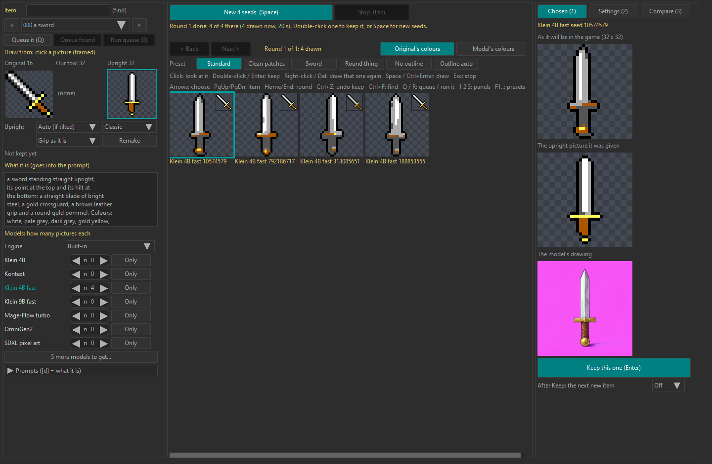
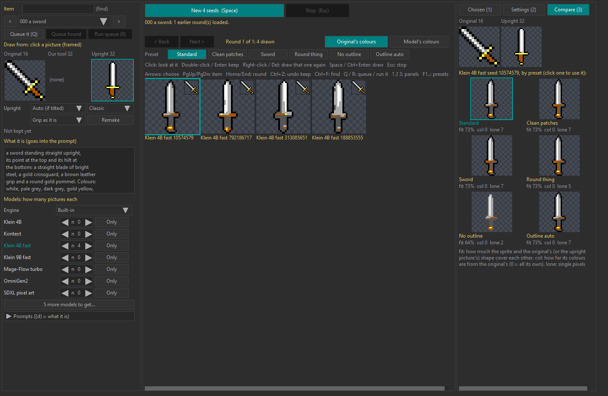
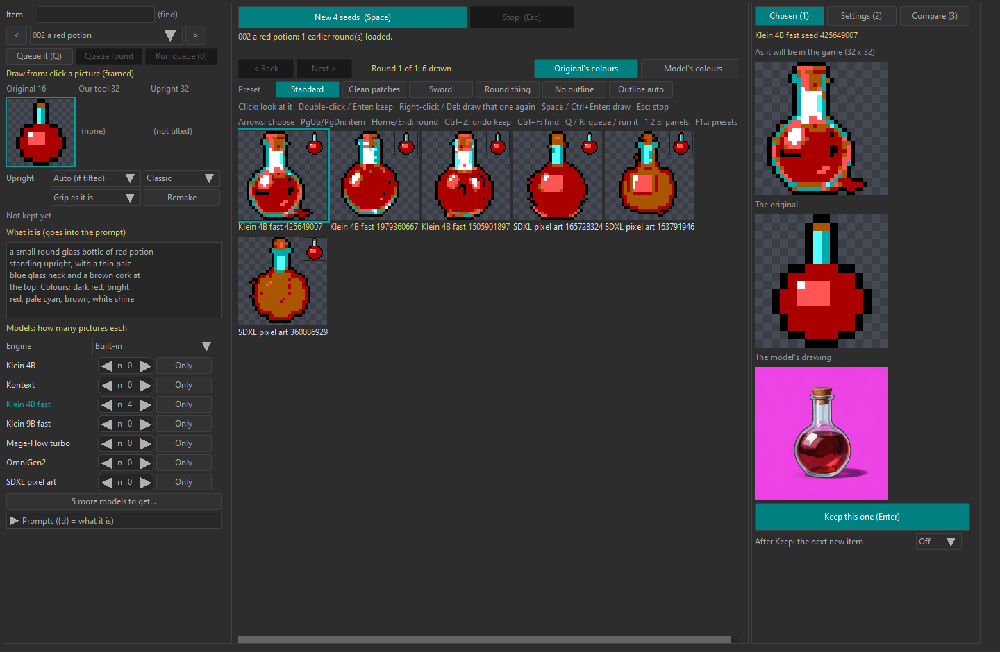
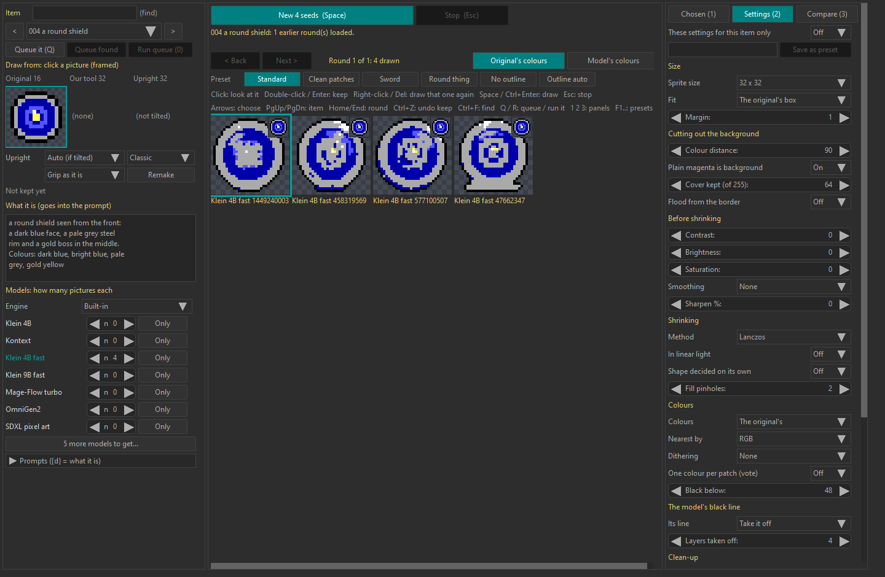
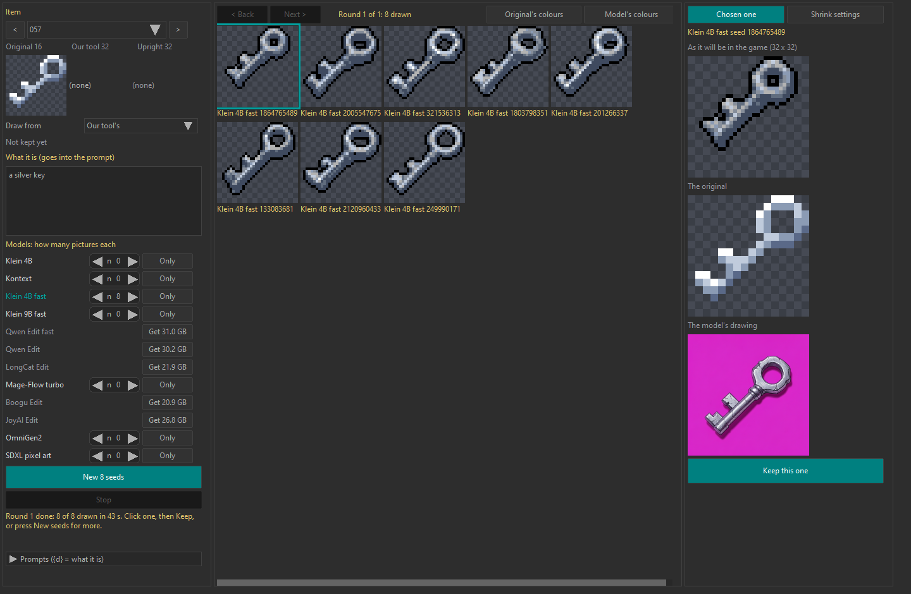

# voxup

Redraws small game sprites with AI image models and lets you pick the best one.

You load a 16 x 16 sprite and voxup asks one or more image models (run in [ComfyUI](https://github.com/comfyanonymous/ComfyUI),
hidden in the background) to redraw it 20 times with random seeds. It shrinks every drawing back into a sprite: 32 x 32,
16 x 16 or any size you type. You see them side by side, press **New 20 seeds** until one is right, click it and press
**Keep**: it is written into your game's sprite folder. Then load the next sprite.

One Windows program in plain C: the window is [Nuklear](https://github.com/Immediate-Mode-UI/Nuklear) with its GDI
backend, pictures are read and written with [stb](https://github.com/nothings/stb). The models run either inside voxup
(the built-in engine, [stable-diffusion.cpp](https://github.com/leejet/stable-diffusion.cpp) on Vulkan, when built with
it) or in ComfyUI, driven over its local HTTP API. No Python of its own, no installer.

## Screenshots
The items in these pictures are five small demo sprites made for this page (`docs/screenshots/demo-items.png`), not
from any game. The drawings are FLUX.2 Klein 4B (distilled) and Stable Diffusion XL + Pixel Art XL, run by the built-in
engine (four pictures in about 20 s on an RTX 4090).



*A sword. On the left the original 16 x 16 sprite and the upright one voxup made from it (framed: the models draw
from it). In the middle the round, each with the original in its corner. On the right the chosen one as it will be in
the game, the upright picture it was given and the model's own drawing.*



*Compare (key 3): the same drawing through every preset, with fit, colour distance and lone pixels. Click one to use
it.*



*Two models in one round: three by Klein 4B fast and three by SDXL pixel art. The potion stands upright already, so
there is no upright picture; the original is framed.*



*Settings (key 2): every step between the drawing and the sprite; changing one redoes the round from the stored
drawings at once.*

## Examples
Free 16 x 16 sprites redrawn as 32 x 32 sprites by voxup with one model, FLUX.2 Klein 4B (distilled, 4 steps, about
5 s a picture). The colours are the original's own, with darker and lighter shades of them. For each item: the
original, the model's drawing, and the sprite voxup shrank it into, all shown at 4x. One seed of 8 was picked per item.


A round is many seeds side by side. Click the one you like; press **New seeds** for more:


The window, after a round of 8 seeds of a key:



The sprites in these pictures are from OpenGameArt and are CC0 (public domain):
[16x16 RPG items](https://opengameart.org/content/16x16-rpg-items) by Jetrel and
[16x16 RPG Icon Pack](https://opengameart.org/content/16x16-rpg-icon-pack) by stealthix. Thank you to both.

## What's new
- **Fewer clicks.** Every feature is one click or one key away: Space draws, double-click or Enter keeps, right-click
  or Delete draws that one picture again, PgUp/PgDn change the item, Ctrl+Z undoes the last keep, 1 2 3 change the
  right panel, F1... take a preset (the full list is below).
- **Draw** and **Stop** sit over the pictures, with the status line under them.
- **Draw from**: click one of the three pictures on the left; the one in use is framed.
- **Find** box: an item by number or name, or `kept`, `new`, `tilted`, `queued`.
- **Queue**: put items on a queue and draw a round of each in turn, e.g. overnight.
- **Presets** bar and the **Compare** panel with scores.
- **Per-item settings**: the shrink settings can be kept for one item only.
- **Upright**: voxup stands a tilted item upright itself (`src/upright.c`), and the models draw from that picture.
- A progress bar on the picture being drawn; **After Keep: the next new item**.
- The models not on the computer yet are folded into one row; the window opens where it was left.
- **Built-in engine**: models can run inside voxup (stable-diffusion.cpp on Vulkan), without ComfyUI.
- Fixed: an item without an enlarged picture no longer points the models at the empty slot; the status line counts
  the whole round after a picture was drawn again.

## Setting it up
1. Build it (below), or put `voxup.exe` in a folder with the `models` folder of this repo beside it.
2. Copy `voxup.ini.example` to `voxup.ini` beside `voxup.exe` and fill in your folders: the original sprites
   (`NNN.png`), ComfyUI's folder, ComfyUI's models folder, and the folder(s) Keep writes into.
3. Start `voxup.exe`.

## Using it
Everything is one click or one key away:

| key / mouse | does |
|---|---|
| click a picture | look at it large (the right panel shows it) |
| double-click, **Enter** or **K** | keep it |
| right-click, **Delete** or **X** | throw it out and draw a new one in its place (it stays out when the item is loaded again; its files stay) |
| **Space**, or **Ctrl+Enter** (also while typing) | draw / new seeds |
| click a picture on the left | the models draw from it |
| **Esc** | stop (and stop the queue) |
| arrow keys | choose a picture in the round |
| **PgUp** / **PgDn** | item before / after (only the items the Find box lets through) |
| **Home** / **End** (or `,` `.`) | earlier / later round |
| **Ctrl+Z** | undo the last keep |
| **Ctrl+F** or **/** | the Find box |
| **Q** / **R** | this item on or off the queue / run the queue |
| **1** **2** **3** | the right panel: Chosen, Settings, Compare |
| **F1**, **F2**, ... | the presets, in the order of the bar |
| **O** / **M** | the original's colours / the model's own |

No key does anything while a text box or a number is being typed in (but Ctrl+Enter); **Esc** leaves the text box.
**Draw** and **Stop** sit over the pictures with the status line under them; the models still to get are folded into
one row (**N more models to get...**). The window comes back where and as big as it was, on the panel it showed.

- **Item**: choose a sprite from the list, or step with `<` and `>`. **Find** narrows the list (and `<` `>`, PgUp/PgDn):
  words that must all fit, each a number (the item's number starts with it), `kept`, `new` (not kept), `tilted`,
  `queued`, or a part of the name; Enter goes to the first. Three pictures are shown: the original, your own
  enlarged one (`enlarged =`) and the item stood upright.
- **Queue**: **Queue it** puts the item on the queue (**Queue found**: every item the Find box lets through); **Run
  queue** draws a round of each in turn, with the model counts and settings as they are, e.g. overnight
  (`work\queue.txt`).
- **Upright**: a hand-made upright picture (`upright =` folders, 32 x 32) always wins. Otherwise voxup stands the item up
  itself (`src/upright.c`): turned with cleanEdge (torcado's pixel-art rotation, no new colours), black outline steps
  only when the original has an outline, drawn at 1.5 x and smaller until it fits 32 x 32. **Auto** does this only
  when the original lies tilted (its long axis 20 to 70 degrees off level; snapped to 45, 26.6 or 63.4 degrees);
  **Turn right 45** / **Turn left 45** force it; **Off**. **Classic** (blade centre between two pixel columns) or
  **Centred** (one-pixel point); the grip as it is, a slimmer sword grip (below the crossguard), or a slimmer shaft.
  It is kept as `work\NNN\upright.png` (a touch-up made there stays) until **Remake**. The models are given the same
  turn drawn large and clean from the original.
- **Draw from**: click one of the three pictures: the models are given that one (it is framed; saved per item; the
  upright one when the item has it). A drawing
  made from the upright picture is shrunk into the upright picture's box. Each has its own description
  (`desc.txt`, `desc-upright.txt`). With no upright description yet, one is made from the other ("lying diagonally"
  becomes "standing straight upright", or a sentence saying so is added); check it before drawing.
- **What it is**: a description of the item; it goes into the prompt in place of `{d}`. Saved per item.
- **Engine**: **Built-in** draws the models that have `sd` lines inside voxup (no ComfyUI; the model stays loaded between
  rounds); **ComfyUI** draws them in ComfyUI. A model only one of them can draw always uses that one.
- **Models**: how many pictures each model draws in a round (0 to 20, at most 40 a round). **Only** = that model alone.
  A model not on your computer yet shows **Get N GB**: its files are downloaded in the background straight into
  ComfyUI's models folder (each file as `.part` until it is complete and the right size; a stopped download goes on
  from where it stopped; files two models share are got once; free disk space is checked first).
- **Draw / New seeds**: ComfyUI is started hidden the first time (about 30 s). Each picture appears as soon as it is
  ready; the one drawing shows its progress (the built-in engine's steps, else the time against that model's usual).
  **Stop** stops after the picture being drawn.
- **< Back / Next >**: earlier rounds; they are kept on disk.
- **Click a picture**: it is shown large beside the original and the model's own drawing. **Keep this one** writes it
  into every `game =` folder of voxup.ini (a picture already there is backed up first, under `work\backup`); one bigger
  than `game_max` goes to `work\export`. Every keep is a line in `work\keep.txt`. **Undo the last keep** puts the
  pictures from before back (a kept picture that replaced nothing is moved to `work\backup\STAMP-undone`, not deleted).
  Each picture in a round shows the original small in its corner. **After Keep: the next new item** goes on to the
  next item not kept yet by itself.
- **Presets** (the bar over the pictures): one click takes a set of shrink settings (Standard, Clean patches, Sword,
  Round thing, No outline, Outline auto, and your own: **Save as preset** in the settings). The size, fit and colours
  stay as they are. The one in use is lit.
- **Compare** (right panel): the chosen drawing through every preset side by side, the original and the upright
  picture beside, each with a score: **fit** (how much the sprite and the original's, or the upright picture's, shape
  cover each other), **col** (how far its colours are from the original's), **lone** (single pixels of a colour).
  Click one to use it.
- **Prompts**: each model's prompt, editable, with a button back to the standard one. For a model that repaints the
  item's picture (Stable Diffusion): **How much may change** (5 to 100 %) and **Its LoRA** (0 to 200 %), saved per model.
- **Shrink settings** (right panel): every step between the model's drawing and the sprite, below. Changing a setting
  makes the shown round again from the stored drawings, without drawing again. **These settings for this item only**
  keeps them in the item's folder (`shrink.txt`); the other items keep the common ones.

## The models
`models/models.txt` lists them. A model can have a ComfyUI API graph `models/ID.json` (written from ComfyUI's own
workflow templates; `"@IMAGE@"`, `"@PROMPT@"`, `"@SEED@"`, `"@PREFIX@"`, `"@STRENGTH@"` and `"@LORA@"` are filled in
for each picture), `sd` lines for the built-in engine (the files it loads and its settings, by stable-diffusion.cpp's
option names), or both. Adding a model is a block in models.txt (and a graph file); no code changes.

| id | model | steps | built-in | ComfyUI |
|---|---|---|---|---|
| klein | FLUX.2 Klein 4B (base) | 20 | yes | yes |
| kontext | FLUX.1 Kontext dev | 24 | yes | yes |
| klein4f | FLUX.2 Klein 4B (distilled) | 4 | yes | yes |
| klein9kv | FLUX.2 Klein 9B KV | 4 | | yes |
| qwen2511f | Qwen-Image-Edit 2511 + Lightning | 4 | | yes |
| qwen2511 | Qwen-Image-Edit 2511 | 40 | | yes |
| longcat | LongCat-Image-Edit | 50 | | yes |
| mageturbo | Mage-Flow-Edit turbo | 4 | | yes |
| boogu | Boogu-Image 0.1 edit | 25 | | yes |
| joyai | JoyAI-Image-Edit | 40 | | yes |
| omnigen2 | OmniGen2 | 20 | | yes |
| sdxlpix | Stable Diffusion XL 1.0 + Pixel Art XL LoRA (repaints the picture) | 30 | yes | yes |

Each model's own licence applies to its files (see their Hugging Face pages, linked in models.txt).

## Shrink settings
In pipeline order (`src/shrink.c`, sources in its header):
- **Size**: 16 x 16, 32 x 32, or any width and height (1 to 128). **Fit**: the original's own box (scaled), the whole
  sprite, or stretched; a margin kept free.
- **Cutting out the background**: distance from the corners' colour; plain magenta too; the cover a pixel needs;
  optionally a flood from the border through near-background pixels (the pink fringe and the model's shadow go too,
  holes inside the item stay).
- **Before shrinking**: contrast, brightness, saturation; median or bilateral smoothing; sharpening at the size of a
  sprite pixel.
- **Method**: Lanczos (standard), Nearest, Box, Bilinear, Bicubic, Mitchell-Netravali, Gaussian, Median, Majority (the
  commonest colour of each pixel's area), **DPID** (Weber et al., *Rapid, Detail-Preserving Image Downscaling*,
  SIGGRAPH Asia 2016), **SAID** (Arjun, Mitra, Ghosh, *Structure Aware Image Downscaling*, arXiv 2510.22551, 2025; the
  paper gives no values, ours are our own reading), **Superpixels** (after Gerstner et al., *Pixelated Image
  Abstraction*, NPAR 2012), **2-step** (Lanczos to 4 x, then the commonest colour 4 x to 2 x to 1 x). Optionally in
  linear light (thin bright and dark edges are not muddied), and the shape decided on its own (half-covered pixels and
  thin lines kept). Then pinholes filled.
- **Colours**: the original's own, the original's with darker and lighter shades, the model's own (background pink
  still snapped), the model's own as drawn, or N colours found (k-means or median cut); nearest by RGB, Lab or weighted
  RGB; Floyd-Steinberg, Atkinson or ordered (Bayer) dithering; or one colour per patch (each patch of like colour
  takes the palette colour most of its pixels are nearest to, in Lab).
- **The model's black line**: take it off (1 to 4 layers) or leave it.
- **Clean-up**: lone pixels take their neighbours' colour; doubled corners in black lines removed.
- **Outline**: none, black, black with corners, selective (a darker shade of the colour beside it), or auto (black
  only when the original has an outline); 1 to 4 pixels thick (1 standard). Black bites into the body can be filled
  and 2 x 2 black blocks broken up. Without an outline the edge can be rough (as shrunk) or smooth (steps evened out with whole
  pixels, no see-through pixels).

## Command line
- `voxup --models`: which models are ready and what each still needs.
- `voxup --to32 DRAWING.png ITEM OUT.png [--own]`: one drawing to the standard 32 x 32 sprite.
- `voxup --shrink DRAWING.png ITEM OUT.png [key=value ...]`: one drawing through any shrink settings (the names are
  those in `work\pick.ini`'s `shrink.` lines, e.g. `method=9 outline=3 othick=2 size=2 cw=24 ch=40`).
- `voxup --upright SPRITE.png OUT.png [turn=auto|DEG] [style=classic|centred] [slim=off|sword|shaft]
  [outline=auto|on|off] [big=PX]`: a sprite stood upright at 32 x 32 (with `big=`: the large clean picture the models
  get).
- `voxup --shrinkcheck DIR`: the pipeline with its standard settings against `--to32` on every drawing in
  `DIR\NNN\*-sSEED.png` (they must be equal).
- `voxup --selftest SHOT.bmp [ITEM] [--get ID] [--draw ID N ...] [--seeds A,B] [--set key=value] [--tab 1] [--from tool|upright|original] [--keep [--undo]] [--find TEXT] [--redraw N] [--key CODE ...] [--click X,Y[,N]]`:
  the window off screen, never shown; it can get a model, draw, set shrink settings, press Keep (into
  `work-selftest\selftest-game`) and undo it, use the Find box, throw picture N out, and press keys (Windows key
  codes, e.g. 34 PgDn, 82 R), click the mouse (N: 1 click, 2 double-click, 3 right-click; never into the real game folders), then writes the window's picture.
- `voxup IN.raw OUT.raw [switches]`: the older voxel upscaler (`src/voxup.c`).

## Building
`build.cmd` with [LLVM clang](https://github.com/llvm/llvm-project) for the MinGW target on the PATH (or set `LLVM_ENV`
to a .cmd that puts it there). It builds `voxup.exe` beside it, drawing with ComfyUI.

### The built-in engine
`build.cmd sd` builds voxup with [stable-diffusion.cpp](https://github.com/leejet/stable-diffusion.cpp) (MIT) inside,
on Vulkan, so models with `sd` lines draw without ComfyUI. stable-diffusion.cpp is not in this repository; get it and
build it first with the same clang and the [Vulkan SDK](https://vulkan.lunarg.com/):

```
git clone --recursive https://github.com/leejet/stable-diffusion.cpp
cmake -S stable-diffusion.cpp -B sd-build -G Ninja -DCMAKE_BUILD_TYPE=Release -DCMAKE_C_COMPILER=clang ^
  -DCMAKE_CXX_COMPILER=clang++ -DSD_VULKAN=ON -DGGML_OPENMP=OFF -DSD_WEBP=OFF -DSD_WEBM=OFF
cmake --build sd-build
set SDCPP=%CD%\stable-diffusion.cpp
set SDCPP_BUILD=%CD%\sd-build
build.cmd sd
```

(clang for MinGW also needs `--target=x86_64-w64-windows-gnu`, `-D_WIN32_WINNT=0x0A00` and `-static` at link time,
in `CMAKE_C_FLAGS`, `CMAKE_CXX_FLAGS` and `CMAKE_EXE_LINKER_FLAGS`.) The engine uses the same model files as ComfyUI.
On the graphics card it shares, voxup asks a ComfyUI it started to let go of its models before drawing built-in.

## Third-party code
`src/third_party`: Nuklear and its GDI backend, stb_image and stb_image_write, each public domain / MIT, at the commits
in `src/third_party/VERSIONS.txt`. stable-diffusion.cpp and its ggml (MIT) are linked in by `build.cmd sd`, not kept here. The resampling follows Pillow's and the model graphs follow ComfyUI's workflow
templates; their notices are in [THIRD_PARTY.md](THIRD_PARTY.md). No AI model is included.

## Credits
Most of voxup was written by Claude, Anthropic's AI, working on the design with the repository's owner.
